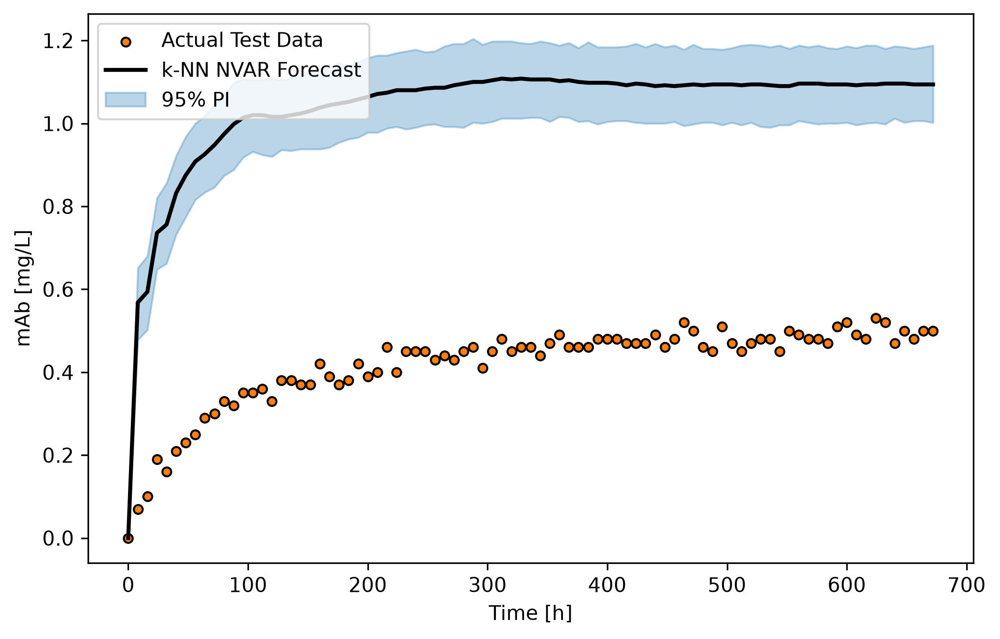
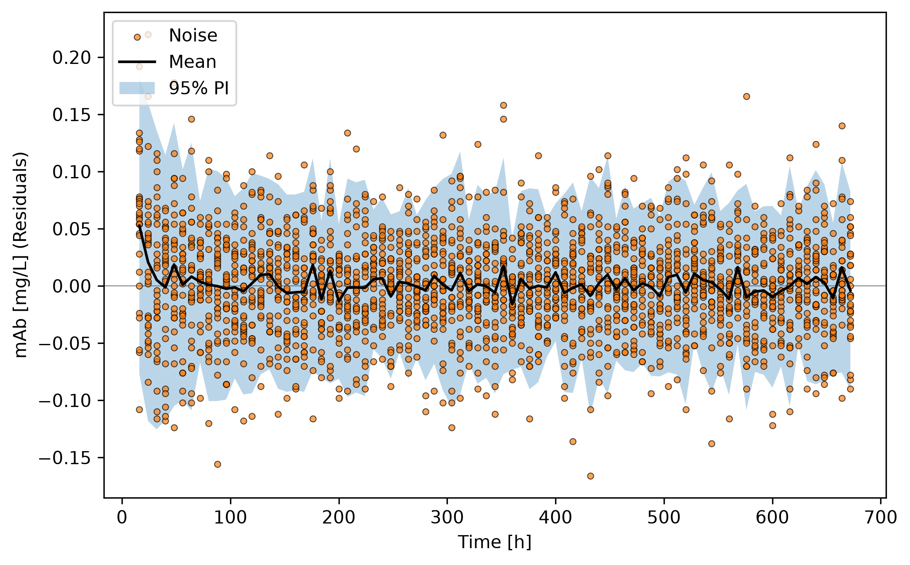
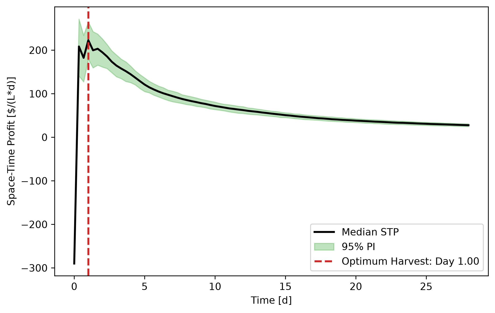

# Monoclonal Antibody Bioprocess Optimizer

This repository contains a machine learning pipeline designed to optimize the space-time profit of a monoclonal antibody (mAb) production process. The code ingests batch time-series datasets, engineers a Non-linear Vector Autoregression (NVAR) architecture using k-Nearest Neighbors, and executes Monte Carlo simulations to predict forecast uncertainty. It solves the complex biochemical engineering problem of identifying the most profitable initial cell culture conditions and optimal harvest time while mathematically accounting for bioreactor downtime.

## Highlights

*   **Designed** a predictive time-series pipeline using Scikit-Learn to model non-linear biochemical reactor dynamics.
*   **Optimized** bioreactor space-time profit through automated hyperparameter tuning and Leave-One-Batch-Out Cross-Validation.
*   **Engineered** lagged variable matrices to transition static datasets into temporal vector autoregression training structures.
*   **Simulated** forecast uncertainty using 1,000 Monte Carlo iterations with sampled white noise to generate 95% prediction intervals.

## Environment

*   Python 3.14.7
*   matplotlib 3.11.0
*   numpy 2.5.2
*   pandas 3.0.5
*   scikit-learn 1.9.0
*   scipy 1.10.0

## Code Design

The predictive and economic optimization workflow is executed sequentially via the `main.py` script. The underlying mathematical operations, matrix transformations, and programmatic logic are modularized into helper functions stored within the `src/functions.py` and `src/classes.py` files. The execution of the pipeline flows through four major structural stages.

### Initialization and Data Partitioning

The execution of the pipeline begins by establishing the local environment and ingesting the raw empirical data. The script utilizes the `pandas` library to read `initial_conditions.csv` alongside the 30 specific batch time-series files selected during the Design of Experiments (DoE) phase. As the individual batch files are ingested, the script dynamically inserts a "Batch ID" column into the resulting DataFrame. This structural addition is critical for downstream processing; time-series data inherently violates the standard machine learning assumption of independent and identically distributed (i.i.d.) variables, as consecutive time points within the same batch are highly correlated. By explicitly tracking the Batch ID, the script ensures that the data can be partitioned cleanly later in the pipeline without breaking the temporal sequence of the bioreactor runs.

### Time-Series Preprocessing and Lag Generation

Once the data is loaded into memory, it must be mathematically transformed into a structure compatible with Vector Autoregression (VAR). Standard regression models map a single row of inputs to a single output. However, in time-series forecasting, the current state of a biological system is heavily dependent on its historical states. 

To resolve this, the script routes the data through a custom lag generation function. For a specified order $p$, the algorithm iterates through the time-series arrays and horizontally concatenates previous time points (e.g., $t-1$, $t-2$) into a single, flattened input vector to predict the current state at time $t$. During this process, the first $p$ rows of every individual batch are skipped to guarantee that the model is never trained on incomplete historical data. By generating these lagged matrices across all features simultaneously (Glucose, Glutamine, Lactate, Ammonia, VCD, TCD, and mAb), the pipeline enables the non-linear model to learn the complex, multi-variable interactions of the cell culture—such as how current glucose consumption is influenced by past viable cell density.

### Pipeline Formulation and Hyperparameter Tuning

With the temporal matrices generated, the script constructs the Non-linear Vector Autoregression (NVAR) pipeline using Scikit-Learn. The pipeline integrates a custom `StandardScalerVAR` transformer and a `KNeighborsRegressor`. Standard scalers cannot be used on VAR data because the lagged variables represent the exact same physical feature shifted in time; scaling them independently would distort their biological relationship. The custom `StandardScalerVAR` calculates the mean and standard deviation across the original feature space and tiles those statistics across the lagged blocks, preserving the relative magnitudes of the historical data.

To tune the model without inducing temporal data leakage, the pipeline is passed into a `GridSearchCV` engine utilizing a `GroupKFold` splitting strategy. Instead of randomly shuffling individual time points (which would allow the model to effectively "see the future" by learning from time $t+1$ to predict time $t$), the cross-validator isolates entire batches. It trains the model on a subset of complete bioreactor runs and tests it on entirely unseen batches. The grid search systematically evaluates various lag orders ($p$) and nearest-neighbor counts ($k$) to identify the optimal architecture that balances bias and variance, ultimately minimizing the Root Mean Square Error (RMSE) of the forecasts.

### Economic Monte Carlo Simulation and Optimization

In the final stage, the script evaluates the economic viability of the bioprocess. Using the optimized NVAR model, it iterates through the batch datasets using a Leave-One-Batch-Out framework. Because a model's point-estimate forecast is insufficient for financial risk assessment, the script executes a Monte Carlo simulation. For each batch, the algorithm generates 1,000 independent recursive forecasts. At every predicted time step, it randomly samples a residual error vector from the model's training phase and injects it as white noise, clipping any physically impossible negative concentrations at zero.

This stochastic simulation yields a distribution of potential mAb trajectories, allowing the script to calculate the 2.5th, 50th, and 97.5th percentiles to establish robust 95% prediction intervals. Finally, the script overlays the economic constraints—calculating the initial cell culture cost based on starting nutrients and cell density, and dividing the projected mAb value by the total elapsed time plus the mandatory 1-day bioreactor turnaround downtime. By tracking this Space-Time Profit trajectory, the algorithm programmatically identifies the exact harvest hour that maximizes financial return, exporting the optimized metrics and associated statistical figures for final analysis.

## Analysis

### Design of Experiments (DoE) Justification

To construct a robust and generalizable predictive model without exhausting computational resources, 30 distinct batch runs were strategically selected from the pool of 1,029 available datasets. Because k-Nearest Neighbors (k-NN) is a non-parametric, distance-based algorithm, its predictive accuracy is strictly bound by the spatial distribution of its training data. It cannot extrapolate beyond the limits of the data it has seen. 

Therefore, a fractional factorial boundary-mapping approach was utilized for the batch selection. Batches were chosen to explicitly capture the absolute minimum, maximum, and central points of the three initial conditions: Glucose [mM], Glutamine [mM], and Viable Cell Density [cells/mL]. By intentionally selecting the extreme biological boundaries (e.g., high glucose with low VCD, or low glutamine with high VCD) alongside stable center points, the 30-batch subset provided the k-NN algorithm with a comprehensive geometric map of the cell culture dynamics. Replicate batches at the optimal center points were also included to ensure the model could accurately quantify the natural, inherent variance (noise) of the biological system without confusing it for a deterministic variable shift.

### Model Architecture and Validation

Based on the Leave-One-Batch-Out Cross-Validation (LOBOCV) evaluation, a Non-linear Vector Autoregression model utilizing k-Nearest Neighbors ($p=2, k=5$) was selected as the optimal architecture for predicting the cell culture kinetics.

*Figure 1: Comparison of the empirical test data against the NVAR(2) k-NN forecast trajectory, including 95% Prediction Intervals.*

The superiority of the k-NN NVAR architecture is evident when modeling the distinct non-linear S-curve (sigmoid) characteristic of monoclonal antibody production. Linear Vector Autoregression (VAR) fails in this domain because it attempts to fit a straight, unbounded line to a fundamentally finite biological process, often failing to predict the metabolic plateau that occurs upon nutrient depletion. Polynomial NVAR models can capture the initial curvature, but because polynomial functions trend toward infinity, they suffer from severe instability during recursive time-series forecasting—frequently predicting physically impossible exponential surges or crashing into negative concentrations.

In contrast, k-NN is empirically constrained by the training data. By averaging the 5 nearest historical points ($k=5$), the model smoothly interpolates the lag vectors ($p=2$) and naturally flattens out when the culture reaches its biological limits. 

*Figure 2: Residual analysis demonstrating that the remaining model noise is randomly distributed around a zero mean.*

The validity of this architecture is confirmed by the white noise residual analysis (Figure 2). For a time-series model to be considered valid, its residual errors must exhibit the properties of white noise: they must have a mean of zero, remain randomly distributed, and show no systematic trends over time. As demonstrated in the residual plot, the moving mean of the model's errors remains tightly anchored to zero throughout the entire batch duration, and the residuals are symmetrically scattered. This proves the k-NN model successfully captured the underlying biochemical patterns in the data, leaving behind only the unpredictable, natural stochastic noise of the physical bioreactor.

### Process Optimization and Economics

The economic viability of mAb production is dictated by a strict mathematical tension between the cost of initial resources and the rate of biological synthesis. The governing metric for this process is Space-Time Profit (STP), which penalizes long, drawn-out fermentations by dividing the total profit by the batch duration plus a mandatory 1-day turnaround downtime.

Through the Monte Carlo simulation pipeline, the optimal biological starting parameters were identified at **Batch 127.0**. The recommended operating conditions and associated 95% prediction intervals are as follows:

*   **Initial Glucose:** 5.0 mM
*   **Initial Glutamine:** 7.0 mM
*   **Initial VCD:** 200,000 cells/mL
*   **Optimal Harvest Time:** 1.00 days
*   **Culture Cost:** $290.00 /L
*   **Value at Harvest:** $736.00 /L
*   **Space-Time Profit:** $223.00 / (L⋅d) (95% PI: 178.00 - 268.03)
*   **Space-Time Yield:** 0.368 mg / (L⋅d)

*Figure 3: Space-Time Profit optimization curve for Batch 127, indicating peak profitability at Day 1.00.*

As visualized in Figure 3, the Space-Time Profit experiences a massive, rapid surge, peaking sharply at Day 1.00 before experiencing a steady, asymptotic decline. This reveals a critical operational dynamic: the financial penalty of the 1-day equipment downtime heavily outweighs the value of the marginal mAb produced in the later stages of the batch.

Biologically, these initial conditions make sense for a rapid-turnaround strategy. By inoculating the reactor with a massive initial cell density (200,000 cells/mL), the culture skips the standard lag phase and immediately begins synthesizing mAb at maximum capacity. Because the batch is intentionally terminated at just 24 hours, the initial nutrient concentrations (Glucose at 5.0 mM and Glutamine at 7.0 mM) can be kept relatively low. Providing excess nutrients would unnecessarily inflate the initial cell culture cost ($/L) because the batch will be harvested long before those expensive raw materials are actually metabolized.

### Practical Applications and Limitations

In an industrial pharmaceutical setting, this pipeline serves as a powerful predictive digital twin. By defining the financial parameters (nutrient cost and mAb market value) alongside the physical plant constraints (downtime), process engineers can use this NVAR algorithm to dynamically shift production strategies. For instance, if market demand for mAb spikes and market value increases, the algorithm can instantly re-evaluate the Space-Time Profit trajectories to recommend new, higher-yield initial conditions.

However, the primary limitation of this model is its reliance on the k-Nearest Neighbors algorithm, which cannot safely extrapolate. If a new, genetically modified cell line is introduced that is capable of surviving at higher toxic lactate thresholds, this model would completely fail to predict its behavior because it has no historical vectors in that numerical space. It is a strictly phenomenological model, meaning it recognizes mathematical similarities but lacks any mechanistic understanding of cellular stoichiometry or fluid thermodynamics. Consequently, any significant changes to the bioreactor impeller geometry, sparge rates, or biological cell lines would render the existing model weights obsolete, necessitating a complete re-execution of the Design of Experiments to map the new bioprocess limits.